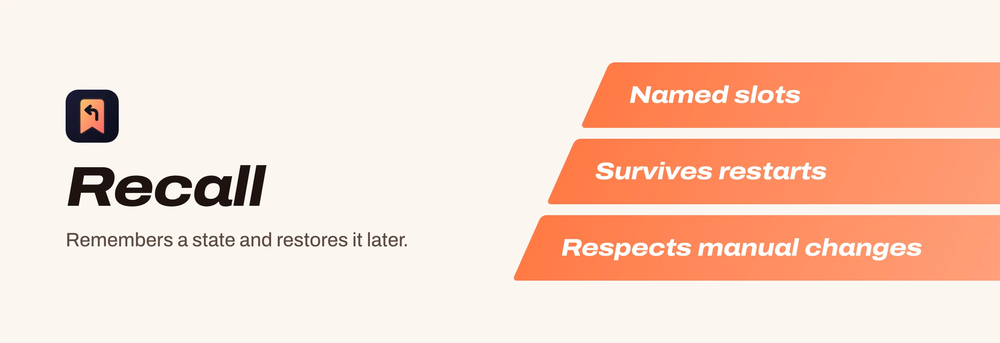

<div align="center">

<picture>
  <source media="(prefers-color-scheme: dark)" srcset="docs/images/readme-title-dark.webp" />
  
</picture>

[](https://github.com/SH1FT-W/recall/releases/latest)
[](https://www.home-assistant.io)
[](https://hacs.xyz)

<a href="https://sh1ft-w.github.io/recall"><b>Website</b></a>&emsp;<a href="#install">Install</a>&emsp;<a href="#actions">Actions</a>&emsp;<a href="#examples">Examples</a>&emsp;<a href="#from-saver">From Saver</a>&emsp;<a href="CHANGELOG.md">Changelog</a>

</div>

<br/>

Many automations change something for a while and put it back afterwards: lights for a movie, blinds for the sun, the thermostat while a window is open. Recall remembers the state and restores it later, **unless someone changed it by hand in the meantime.** Named slots keep two automations on the same device apart, and everything survives restarts. No more `input_boolean.*_controlled_by_automation` helpers.

Recall replaces [Saver](https://github.com/PiotrMachowski/Home-Assistant-custom-components-Saver) but is an independent project with no code from it. It is used every day with lights and blinds; climate, fans, media players and the other domains are covered by the automated tests only.

## Restore or skip

What `recall.restore` does, depending on what happened since `recall.save`:

| Since `recall.save` | `recall.restore` |
|:--|:--|
| Nothing changed after the automation was done | restores |
| Changed by hand, in the UI or by another automation | skips, reason `manual` with what changed |
| Changed and then put back to what the automation left | restores |
| The device is moving right now | skips, reason `moving` |
| Another slot remembered exactly the expected state and moved it | hands over to that slot, nothing moves |
| The device is unavailable | skips and keeps it for a later try |
| `only_if_unchanged: false` | restores anyway |

**New in 26.11:** `recall.create_scene` turns a slot into a scene, and a renamed entity keeps its remembered states. Every change is in the [changelog](CHANGELOG.md) (German).

<a id="install"></a>
## Install

[](https://my.home-assistant.io/redirect/hacs_repository/?owner=SH1FT-W&repository=recall&category=integration)

Search for **Recall** under **Settings > Marketplace** (called HACS before Home Assistant 2026.11), download it and restart Home Assistant. Then add it under **Settings > Devices & services > Add integration > Recall**. No questions asked.

<details>
<summary>Install by hand</summary>

1. Download the [latest release](https://github.com/SH1FT-W/recall/releases/latest).
2. Copy `custom_components/recall` into `/config/custom_components/` and restart Home Assistant.

</details>

**Settings > Devices & services > Recall > Configure** holds the defaults (respect manual changes, forget afterwards, tolerance 3 %, calm time 15 s, expiry) and the list of remembered states, where you can forget slots without moving anything. Changes apply right away.

<a id="actions"></a>
## Actions

| Action | Does |
|:--|:--|
| `recall.save` | Remembers entities, devices, areas, floors or labels in a `slot`, with optional `expires_after`, `overwrite` and `tolerance`. |
| `recall.restore` | Puts the slot back and skips what was changed (see above). `forget` afterwards and a light `transition` are optional. |
| `recall.forget` | Drops a whole slot or single entities without moving anything. |
| `recall.create_scene` | Creates `scene.recall_<scene_id>` from a slot, like `scene.create`: dynamic until restart, the slot stays. |
| Condition `recall.is_saved` | True when every target is remembered in the slot, with `unchanged: true` only if nobody changed it. |
| `sensor.recall_saved_states` | Number of remembered entities. Attribute `slots` shows saved, expected and `changed_by` per entity (not recorded). |

Every action returns what it did, and fires `recall_saved`, `recall_restored`, `recall_skipped` or `recall_forgotten` with `slot` and `entity_id`.

<details>
<summary>Fields and responses</summary>

**`recall.save`**

| Field | Default | |
|:--|:--|:--|
| target | | Entities, devices, areas, floors or labels |
| `slot` | `default` | Name of the memory slot |
| `expires_after` | setting | Forget automatically after this time; `0` = never |
| `overwrite` | `true` | `false` keeps a state already remembered in the slot (the *original* one) |
| `tolerance` | setting (3) | Percentage points position, tilt, brightness, fan speed or volume may drift before it counts as a manual change |

Response: `{slot, saved: [...], kept: [...], missing: [...]}`.

**`recall.restore`**

| Field | Default | |
|:--|:--|:--|
| `entity_id` (or `target`) | all of the slot | Restore only these entities (`target` with areas, devices or labels works in YAML) |
| `slot` | `default` | |
| `only_if_unchanged` | setting (on) | Skip entities changed by hand or by another automation |
| `forget` | setting (on) | Forget afterwards (also when skipped because of a manual change) |
| `transition` | | Light fade in seconds |

Response: `{slot, restored: [...], skipped: [{entity_id, reason, detail, changed_by}]}`. Reasons: `manual` (detail e.g. `current_position: 40 → 70`, `changed_by` = `user`, `automation`, `device`, `recall` or `unknown`), `moving`, `handed_over` (detail = the slot that took over), `unavailable`, `unsupported` (the domain has no `reproduce_state`) and `not_saved` (also for an empty slot).

**`recall.forget`**: slot only removes the whole slot; `entity_id` or `target` only removes these entities in every slot. An unknown slot answers `skipped: [{slot, reason: not_saved}]`.

**`recall.create_scene`**

| Field | Default | |
|:--|:--|:--|
| `entity_id` (or `target`) | all of the slot | Only these entities |
| `slot` | `default` | |
| `scene_id` | slot name as a slug | Always prefixed with `recall_` (not doubled), e.g. `before_movie` becomes `scene.recall_before_movie` |

Response: `{slot, scene, entity_id: [...], skipped: [...]}`. The scene holds the remembered state with the attributes a restore would use and is not written to `scenes.yaml`; calling it again with the same `scene_id` replaces it. The `recall_` prefix keeps it apart from your own scenes and those of Hue & Co. Fails if nothing in the slot fits, if the `scene` integration is not loaded, or if a scene from `scenes.yaml` already uses that ID.

**Condition `recall.is_saved`**: a hand-over to another slot does not count as a change. Old-style `group.*` targets resolve to their members.

**Events**: `recall_skipped` carries `reason`, `detail` and `changed_by`; `recall_forgotten` carries `reason` (`action`, `restore`, `handed_over`, `expired`, `entity_removed`). Entities deleted from the entity registry are forgotten automatically.

**Sensor attribute `slots`**: per entity `saved_state`, `saved` (short, e.g. `70 % · tilt 30 %`), `saved_at`, `expires_at`, `settled`, `expected_state`, `expected`, `changed_manually`, `changed_by` (`unknown` if it changed while Home Assistant was off), `changed_at` and `handed_over_to`.

</details>

<a id="examples"></a>
## Examples

Blind half closed while the Apple TV plays, back when it stops, unless someone moved it:

```yaml
triggers:
  - trigger: state
    entity_id: media_player.apple_tv
    to: playing
    id: play
  - trigger: state
    entity_id: media_player.apple_tv
    to: "off"
    id: stop
actions:
  - choose:
      - conditions:
          - condition: trigger
            id: play
        sequence:
          - action: recall.save
            target:
              entity_id: cover.living_room
            data:
              slot: apple_tv
              expires_after: "12:00:00"
          - action: cover.set_cover_position
            target:
              entity_id: cover.living_room
            data:
              position: 40
      - conditions:
          - condition: trigger
            id: stop
        sequence:
          - action: recall.restore
            data:
              slot: apple_tv
```

<details>
<summary>Tell me when it was left alone</summary>

```yaml
- action: recall.restore
  data:
    slot: apple_tv
  response_variable: recall
- if: "{{ recall.skipped | selectattr('reason', 'eq', 'manual') | list | count > 0 }}"
  then:
    - action: notify.mobile_app_phone
      data:
        message: "Blind left as it is, you moved it yourself."
```

</details>

<details>
<summary>Wall switch: always restore, with a fade</summary>

Here the switch is the user's intent, so restore regardless:

```yaml
- action: recall.restore
  data:
    slot: wall_switch
    only_if_unchanged: false
    transition: 3
```

</details>

<details>
<summary>Only if nobody touched it, as a condition</summary>

```yaml
conditions:
  - condition: recall.is_saved
    target:
      entity_id: cover.living_room
    options:
      slot: apple_tv
      unchanged: true
```

</details>

<details>
<summary>Two slots on the same blind</summary>

The PS5 remembers the blind at 70 % in `ps5` and moves it to 50 %. Then the Apple TV remembers those 50 % in `apple_tv` and moves it to 40 %. If the PS5 is switched off first, the blind is not where `ps5` expected it, but only because `apple_tv` remembered exactly that state. That is not a manual change: Recall hands over. `apple_tv` now remembers 70 %, nothing moves, `ps5` is forgotten. Switching off the Apple TV then goes back to 70 %. The other order goes back step by step. Works with any number of slots in any order.

</details>

<a id="from-saver"></a>
## From Saver

| Saver | Recall |
|:--|:--|
| `saver.save_state` | `recall.save` (+ `slot`) |
| `saver.restore_state` | `recall.restore` (+ `slot`) |
| `delete_after_run: false` | `forget: false` |
| `saver.delete` | `recall.forget` |
| "controlled by automation" helper + condition | not needed, `only_if_unchanged` is the default |
| `saver_entity()` in templates | sensor attribute `slots` or condition `recall.is_saved` |
| `saver.set_variable` / `saver_variable()` | not part of Recall, use an `input_text` or `input_datetime` helper |

States remembered by Saver are not taken over: switch automations at a moment nothing is waiting to be restored. While Saver is still set up, Recall shows a repair notice as a reminder.

<details>
<summary>Before and after</summary>

```yaml
# Saver
- action: saver.save_state
  data:
    entity_id: [cover.living_room]
- action: cover.set_cover_position
  target: {entity_id: cover.living_room}
  data: {position: 40}
- action: input_boolean.turn_on
  target: {entity_id: input_boolean.blind_controlled_by_tv}
# later
- if:
    - condition: state
      entity_id: input_boolean.blind_controlled_by_tv
      state: "on"
  then:
    - action: saver.restore_state
      data:
        entity_id: [cover.living_room]
    - action: input_boolean.turn_off
      target: {entity_id: input_boolean.blind_controlled_by_tv}
```

```yaml
# Recall
- action: recall.save
  target: {entity_id: cover.living_room}
  data: {slot: tv}
- action: cover.set_cover_position
  target: {entity_id: cover.living_room}
  data: {position: 40}
# later
- action: recall.restore
  data: {slot: tv}
```

</details>

## Good to know

- **Buttons on the device itself** cannot be told apart from the device reporting its own travel. A change in the first seconds after `recall.save`, before the device is calm, is taken as the automation's target. Changes in the UI or by other automations are recognised at any time.
- **A later step in a new run** of the same automation (another trigger) counts as a manual change. Call `recall.save` with `overwrite: false` right before it to register it as the automation's own.
- **Saving an unavailable entity** is not possible (`missing` in the response).
- **Lights** remembered with a colour mode but without its value come back with on/off and brightness.

<details>
<summary>Troubleshooting</summary>

- **Restore skipped although nobody touched it.** Look at `detail` in the response or the `recall_skipped` event, e.g. `current_position: 40 → 45`, and raise `tolerance` on `recall.save`.
- **Restore happened although someone changed it.** The change probably came from the device's own button within the settling window, or `only_if_unchanged` is off.
- **Diagnostics:** **Settings > Devices & services > Recall > three dots > Download diagnostics** shows every slot with saved, expected and current state, the settings and whether a restore would be skipped. Sensitive attributes (`access_token`, `entity_picture`, coordinates) are redacted.
- **Debug log:**

  ```yaml
  logger:
    logs:
      custom_components.recall: debug
  ```

</details>

<details>
<summary>Remove</summary>

1. **Settings > Devices & services > Recall > three dots > Delete.** Remembered states are deleted with it.
2. Remove the repository in the Marketplace (or delete `/config/custom_components/recall`) and restart Home Assistant.

</details>

<details>
<summary>How it works</summary>

1. **Remember.** `recall.save` stores the current state in `.storage/recall.snapshots` and registers the automation run that called it.
2. **Settle.** Every change by that run restarts a quiet window (15 s); `opening` and `closing` never count as finished. Nothing happens at all: after 60 s the saved state is the expected one. Never quiet: after 10 minutes the last calm state is used. A command from someone else while settling ends it right away.
3. **Restore or skip.** Any other change is compared with the expected state:

| Domain | Compared |
|:--|:--|
| cover, valve | position and tilt ± tolerance (state if no position) |
| light | on/off, brightness ± tolerance, colour mode, colour temperature ± 150 K, hue and saturation ± 10, effect |
| climate | HVAC mode, target temperature(s) ± 0.5, preset, fan mode |
| fan | on/off, percentage ± tolerance, preset, oscillation, direction |
| media_player | on/off, volume ± tolerance, source, sound mode (not playing or paused) |
| humidifier, water_heater | state, target ± tolerance or 0.5, mode |
| number, input_number | numeric value |
| everything else | state |

Restoring goes through Home Assistant's `async_reproduce_state`, the same path scenes use, with the context of the calling automation. One state listener covers all remembered entities, one timer handles settling and expiry. Details, in German, are in [`CLAUDE.md`](CLAUDE.md).

</details>

<details>
<summary>Development</summary>

```bash
.venv/bin/python -m pytest -q -p no:logging --cov=custom_components.recall   # fake devices in tests/common.py
uvx ruff check . && uvx ruff format --check .
uvx mypy@2.3.1 --python-executable .venv/bin/python
.venv/bin/python tools/pruefe-uebersetzungen.py    # strings.json against translations/*.json
```

Test requirements: `pip install -r requirements_test.txt`. GitHub Actions runs the same checks plus HACS validation and hassfest. Quality scale: platinum, [self-assessed](custom_components/recall/quality_scale.yaml).

</details>

## License

[Apache License 2.0](LICENSE), Copyright 2026 SH1FT-W. Acknowledgements in [`NOTICE`](NOTICE).
