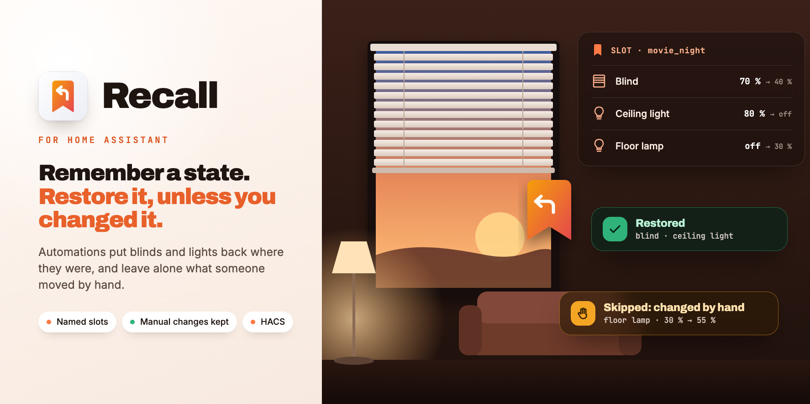
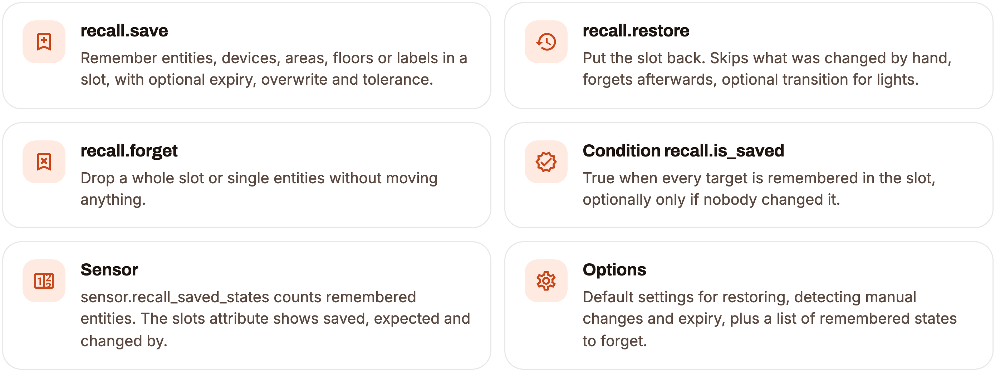
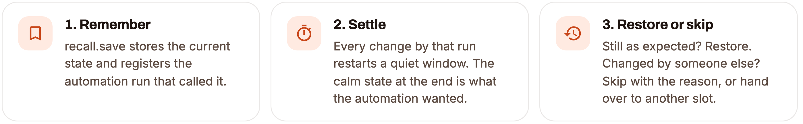

<div align="center">



<p>Remember a state, restore it later, unless someone changed it by hand in the meantime.<br/>
A modern replacement for <b>Saver</b>.</p>

[](https://github.com/SH1FT-W/recall/releases/latest)
[](https://www.home-assistant.io)
[](https://hacs.xyz)
[](https://developers.home-assistant.io/docs/creating_integration_manifest/#iot-class)
[-FF7A45?style=flat-square&labelColor=111111)](custom_components/recall/quality_scale.yaml)
[](LICENSE)

<p><a href="https://sh1ft-w.github.io/recall"><b>Website</b></a> &nbsp;·&nbsp; <a href="#features">Features</a> &nbsp;·&nbsp; <a href="#actions">Actions</a> &nbsp;·&nbsp; <a href="#installation">Install</a> &nbsp;·&nbsp; <a href="#migrating-from-saver">From&nbsp;Saver</a> &nbsp;·&nbsp; <a href="#troubleshooting">Troubleshooting</a> &nbsp;·&nbsp; <a href="CHANGELOG.md">Changelog</a></p>

</div>

<br/>

Automations often do *"remember the blind, move it, put it back later"*. The usual tool for that is [Saver](https://github.com/PiotrMachowski/Home-Assistant-custom-components-Saver). Recall does the same job and fixes what made Saver awkward in practice: it **notices when someone took over** and leaves that device alone, keeps **named slots** so two automations do not overwrite each other, and **survives restarts**. No more `input_boolean.*_controlled_by_automation` helpers.

> [!NOTE]
> Recall is an independent project. It is not affiliated with Saver or its author, and contains no code from it.

**Tested on:** used every day with lights and blinds (wall switches and TV automations). Climate, fans, media players and the other domains in the table below are covered by the automated tests only.

<a id="features"></a>
## Features

<picture>
  <source media="(prefers-color-scheme: dark)" srcset="docs/images/readme-cards-features-dark.png" />
  
</picture>

<picture>
  <source media="(prefers-color-scheme: dark)" srcset="docs/images/readme-cards-entities-dark.png" />
  
</picture>

<a id="actions"></a>
## Actions

### `recall.save`

| Field | Default | |
|---|---|---|
| target | | Entities, devices, areas, floors or labels |
| `slot` | `default` | Name of the memory slot |
| `expires_after` | setting | Forget automatically after this time; `0` = never |
| `overwrite` | `true` | `false` keeps a state already remembered in the slot (the *original* one) |
| `tolerance` | setting (3) | Percentage points position/tilt/brightness/fan speed/volume may drift before it counts as a manual change |

Response: `{slot, saved: [...], kept: [...], missing: [...]}`.

### `recall.restore`

| Field | Default | |
|---|---|---|
| `entity_id` (or `target`) | all of the slot | Restore only these entities (`target` with areas/devices/labels works in YAML) |
| `slot` | `default` | |
| `only_if_unchanged` | setting (on) | Skip entities changed by hand or by another automation |
| `forget` | setting (on) | Forget afterwards (also when skipped because of a manual change) |
| `transition` | | Light fade in seconds |

Response: `{slot, restored: [...], skipped: [{entity_id, reason, detail}]}` with reason
`manual` (detail e.g. `current_position: 40 → 70`, `changed_by` = `user`/`automation`/`device`/`recall`/`unknown`),
`moving` (someone else is moving it right now), `handed_over` (detail = the slot that took over, see below),
`unavailable` (kept for a later try), `unsupported` (the domain cannot be restored by Home Assistant) or `not_saved`
(also for a slot that holds nothing: `entity_id: null`, detail `slot … is empty`). Every item has
`{entity_id, reason, detail, changed_by}`.

#### Handing over between slots

Two automations with their own slots on the same device, e.g. PS5 remembers the blind at 70 % in `ps5` and moves it
to 50 %, then the Apple TV remembers those 50 % in `apple_tv` and moves it to 40 %. If the PS5 is switched off
first, the blind is not where `ps5` expected it, but only because `apple_tv` remembered exactly that expected
state and moved it afterwards. That is not a manual change: Recall **hands over**. `apple_tv` now remembers 70 %,
nothing moves, `ps5` is forgotten (`reason: handed_over`, event `recall_forgotten` with `reason: handed_over`).
Switching off the Apple TV then goes back to 70 %. The other order works as before. A real manual change after the
second slot remembered is then detected by that slot; another automation *without* a Recall slot still counts as a
manual change (`changed_by: automation`). Works with any number of slots in any order.

### `recall.forget`

Removes remembered states without restoring. Slot only → whole slot; `entity_id`/`target` only → these entities in
every slot. An unknown slot answers `skipped: [{slot, reason: not_saved}]`.

### Condition `recall.is_saved`

True if every target entity has a remembered state in the slot; with `unchanged: true` also nobody changed it (a
hand-over to another slot does not count as a change). Old-style `group.*` targets resolve to their members, exactly
like in the actions. The orange × / green ✓ on its icon in the automation editor is Home Assistant's live check.

```yaml
conditions:
  - condition: recall.is_saved
    target:
      entity_id: cover.living_room
    options:
      slot: apple_tv
      unchanged: true
```

### Events

`recall_saved`, `recall_restored`, `recall_skipped` (with `reason`, `detail`, `changed_by`), `recall_forgotten`
(with `reason`: `action`, `restore`, `handed_over`, `expired`, `entity_removed`). All carry `slot` and `entity_id`.
Entities deleted from the entity registry are forgotten automatically.

### Sensor

`sensor.recall_saved_states`: number of remembered entities. Attribute `slots` lists every slot and entity with
`saved_state`, `saved` (short, e.g. `70 % · tilt 30 %` or `on · 80 % · 2700 K`), `saved_at`, `expires_at`, `settled`,
`expected_state`, `expected`, `changed_manually`, `changed_by` (`user`/`automation`/`device`/`recall`, `unknown` if
it changed while Home Assistant was off), `changed_at` and `handed_over_to`. The attribute is not written to the recorder.

<a id="configuration"></a>
## Configuration

**Settings > Devices & services > Recall > Configure** opens a menu:

- **Default settings:** used whenever an action does not set the field itself; changes apply immediately, no
  restart. *Restoring:* respect manual changes (`only_if_unchanged`, on), forget afterwards (`forget`, on).
  *Detecting manual changes:* tolerance (3 %), calm time (15 s), wait when nothing happens (60 s), longest wait
  (10 min). *Expiry:* forget after (empty = never; `expires_after: 0` in an action overrides it with “never”).
- **Remembered states:** lists every slot and entity with what is remembered (position/tilt, brightness/colour
  temperature …) and when it expires (⏳); ✋ = changed by hand since, ↪ = will be handed over to that slot. Forgets
  the slots you tick, without moving anything.

## How manual changes are detected

1. **Settling.** Right after `recall.save` the automation usually moves the device. Every change restarts a 15 s (configurable)
   quiet window; travel states (`opening`/`closing`) never count as finished. Nothing changes at all → after
   60 s the saved state is the expected one. Never quiet → after 10 min the last calm state is used.
2. **Expected.** The calm state at the end is what the automation wanted. Changes made later *by the same
   automation run* (same context, e.g. after a `delay`) start step 1 again. Any other change is compared with the
   expected state:

   | Domain | Compared |
   |---|---|
   | cover, valve | position and tilt ± tolerance (state if no position) |
   | light | on/off, brightness ± tolerance, colour mode, colour temperature ± 150 K, hue/saturation ± 10, effect |
   | climate | HVAC mode, target temperature(s) ± 0.5, preset, fan mode |
   | fan | on/off, percentage ± tolerance, preset, oscillation, direction |
   | media_player | on/off, volume ± tolerance, source, sound mode (not playing/paused) |
   | humidifier, water_heater | state, target ± tolerance/0.5, mode |
   | number, input_number | numeric value |
   | everything else | state |

3. **Restore.** Still as expected (or still settling) → restore. Otherwise skip with reason. Going back to the
   expected state by hand counts as unchanged again.

A command from someone else *while settling* (a user in the Home Assistant UI or another automation) ends the
settling right away with the last calm state, so even an immediate manual change is noticed.

## Examples

```yaml
# Blind half closed while the Apple TV plays, back when it stops, unless someone moved it
triggers:
  - trigger: state
    entity_id: media_player.apple_tv
    to: playing
    id: play
  - trigger: state
    entity_id: media_player.apple_tv
    to: "off"
    id: stop
actions:
  - choose:
      - conditions:
          - condition: trigger
            id: play
        sequence:
          - action: recall.save
            target:
              entity_id: cover.living_room
            data:
              slot: apple_tv
              expires_after: "12:00:00"
          - action: cover.set_cover_position
            target:
              entity_id: cover.living_room
            data:
              position: 40
      - conditions:
          - condition: trigger
            id: stop
        sequence:
          - action: recall.restore
            data:
              slot: apple_tv
```

Using the response:

```yaml
- action: recall.restore
  data:
    slot: apple_tv
  response_variable: recall
- if: "{{ recall.skipped | selectattr('reason', 'eq', 'manual') | list | count > 0 }}"
  then:
    - action: notify.mobile_app_phone
      data:
        message: "Blind left as it is, you moved it yourself."
```

A light that a wall switch turns to full brightness and back. Here the switch is the user’s intent, so always
restore:

```yaml
- action: recall.restore
  data:
    slot: wall_switch
    only_if_unchanged: false
    transition: 3
```

A later step of the same automation that runs in a *new* run (another trigger) should be counted as the
automation’s own: call `recall.save` with `overwrite: false` right before it. The original state is kept and the
new run is registered as the automation’s own.

<a id="migrating-from-saver"></a>
## Migrating from Saver

| Saver | Recall |
|---|---|
| `saver.save_state` | `recall.save` (+ `slot`) |
| `saver.restore_state` | `recall.restore` (+ `slot`) |
| `delete_after_run: false` | `forget: false` |
| `transition` | `transition` |
| `saver.delete` | `recall.forget` |
| “controlled by automation” helper + condition | not needed, `only_if_unchanged` (default) |
| `saver_entity()` in templates | sensor attribute `slots` or condition `recall.is_saved` |
| `saver.set_variable` / `saver_variable()` | not part of Recall, use an `input_text`/`input_datetime` helper |

Before:

```yaml
- action: saver.save_state
  data:
    entity_id: [cover.living_room]
- action: cover.set_cover_position
  target: {entity_id: cover.living_room}
  data: {position: 40}
- action: input_boolean.turn_on
  target: {entity_id: input_boolean.blind_controlled_by_tv}
# later
- if:
    - condition: state
      entity_id: input_boolean.blind_controlled_by_tv
      state: "on"
  then:
    - action: saver.restore_state
      data:
        entity_id: [cover.living_room]
    - action: input_boolean.turn_off
      target: {entity_id: input_boolean.blind_controlled_by_tv}
```

After:

```yaml
- action: recall.save
  target: {entity_id: cover.living_room}
  data: {slot: tv}
- action: cover.set_cover_position
  target: {entity_id: cover.living_room}
  data: {position: 40}
# later
- action: recall.restore
  data: {slot: tv}
```

States remembered by Saver are not taken over: switch automations over at a moment nothing is waiting to be
restored. While Saver is still set up, Recall shows a repair notice as a reminder.

<a id="installation"></a>
## Installation

**Requirements:** Home Assistant 2026.9 or newer.

### HACS (custom repository)

1. In HACS, open the three dots menu, choose **Custom repositories** and add `https://github.com/SH1FT-W/recall` with the type **Integration**.
2. Search for **Recall**, download it and restart Home Assistant.

### Manual

1. Download the [latest release](https://github.com/SH1FT-W/recall/releases/latest).
2. Copy the folder `custom_components/recall` into `/config/custom_components/` and restart Home Assistant.

### Setup

**Settings > Devices & services > Add integration > Recall.** No questions asked.

## Good to know

- **Same device in two slots** works in any order: restoring the inner slot first goes back step by step; restoring
  the outer slot first hands its remembered state over to the inner one (see *Handing over between slots*).
- **Buttons on the device itself** cannot be told apart from the device reporting its own travel. A manual change
  in the first seconds after `recall.save` (before the device is calm) is therefore taken as the automation’s
  target. Changes in the Home Assistant UI or by other automations are recognised at any time.
- **Moving at restore time**: if the device is travelling (`opening`/`closing`) after the automation was done,
  someone else moves it, so restore is skipped (`moving`).
- **Unavailable** devices are skipped and stay remembered.
- **Saving while unavailable** is not possible (`missing` in the response).
- Restoring uses each domain’s `reproduce_state`; domains without one (e.g. `sensor`) are skipped with `unsupported`.
- **Lights** remembered with a colour mode but without its value (e.g. `color_temp` with `color_temp_kelvin: null`)
  come back with on/off and brightness instead of being skipped silently.

<a id="troubleshooting"></a>
## Troubleshooting

- **Restore skipped although nobody touched it.** Look at `detail` in the response or the `recall_skipped` event,
  e.g. `current_position: 40 → 45`: raise `tolerance` on `recall.save`.
- **Restore happened although someone changed it.** The change probably came from the device’s own button within
  the settling window (see above), or `only_if_unchanged` is off.
- **Diagnostics:** **Settings > Devices & services > Recall > three dots > Download diagnostics** shows every slot with saved,
  expected and current state, the settings and whether a restore would be skipped. Sensitive attributes
  (`access_token`, `entity_picture`, coordinates, …) are redacted.
- **Debug log:**

  ```yaml
  logger:
    logs:
      custom_components.recall: debug
  ```

## Removal

1. **Settings > Devices & services > Recall > three dots > Delete.** Remembered states are deleted with it.
2. Delete `/config/custom_components/recall` and restart Home Assistant.

## How it works

<picture>
  <source media="(prefers-color-scheme: dark)" srcset="docs/images/readme-cards-how-dark.png" />
  
</picture>

Recall keeps one state listener for all remembered entities and one timer for settling and expiry. Restoring goes through Home Assistant's `async_reproduce_state`, the same path scenes use, with the context of the calling automation. Details, in German, are in [`CLAUDE.md`](CLAUDE.md).

## Development

```bash
.venv/bin/python -m pytest -q -p no:logging --cov=custom_components.recall   # fake devices in tests/common.py
uvx ruff check . && uvx ruff format --check .
uvx mypy@2.3.1 --python-executable .venv/bin/python
.venv/bin/python tools/pruefe-uebersetzungen.py    # strings.json against translations/*.json
```

Install the test requirements with `pip install -r requirements_test.txt`. The same checks run on GitHub Actions for every push and pull request, plus HACS validation and hassfest. Self-assessed state of the [Integration Quality Scale](https://developers.home-assistant.io/docs/core/integration-quality-scale/): [`quality_scale.yaml`](custom_components/recall/quality_scale.yaml).

## License

[Apache License 2.0](LICENSE), Copyright 2026 SH1FT-W. See [`NOTICE`](NOTICE) for acknowledgements.
